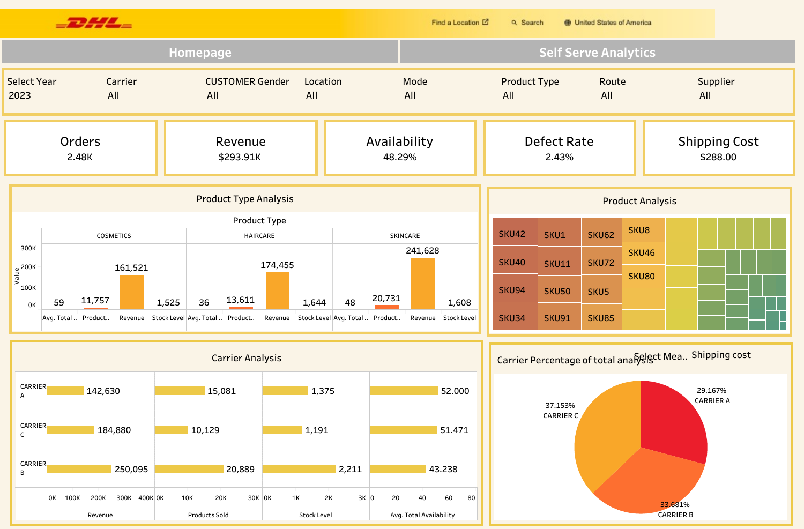

# 🚚 DHL Supply Chain Analytics Dashboard

An interactive Tableau dashboard tracking **orders, revenue, availability, defect rate, and shipping cost** across 100 SKUs, 5 suppliers, and 3 carriers.

### 🔗 [View the Live Dashboard](https://public.tableau.com/app/profile/supriya.kumari.kushwaha/viz/DHL_supplychain_viz/Homepage)

---

## 🔍 Key Insights

| | Insight |
|---|---|
| 🧴 | **Skincare** leads revenue at **$241.6K**, about 42% of the $577.6K total |
| 🚛 | **Carrier B** moves the most units (**45%**) but has the **lowest availability** (43% vs. 51 to 52%) |
| 💸 | **Carrier C** accounts for **37% of shipping cost** while moving only **22% of units** |
| 📦 | **Carrier A** has the highest average availability at **52%** |

## 🧭 Dashboard Features

- **KPI tiles** for orders, revenue, availability, defect rate, and shipping cost
- **Product type and SKU analysis** with a revenue treemap
- **Carrier comparison** across revenue, units sold, stock level, and availability
- **Parameter control** to switch the carrier share chart between measures
- **Filters** for year, carrier, location, mode, product type, route, and supplier

## 🛠️ Tools

Tableau (LOD expressions, parameters, calculated fields) · SQL

## 🚀 Next Steps

- Compare **shipping cost per unit** by carrier to confirm whether Carrier C is overpriced
- Investigate the **availability gap** for Carrier B's high volume products

---

This project demonstrates expertise in data visualization, ETL processes, and supply chain analytics while delivering significant business impact through technical innovation
